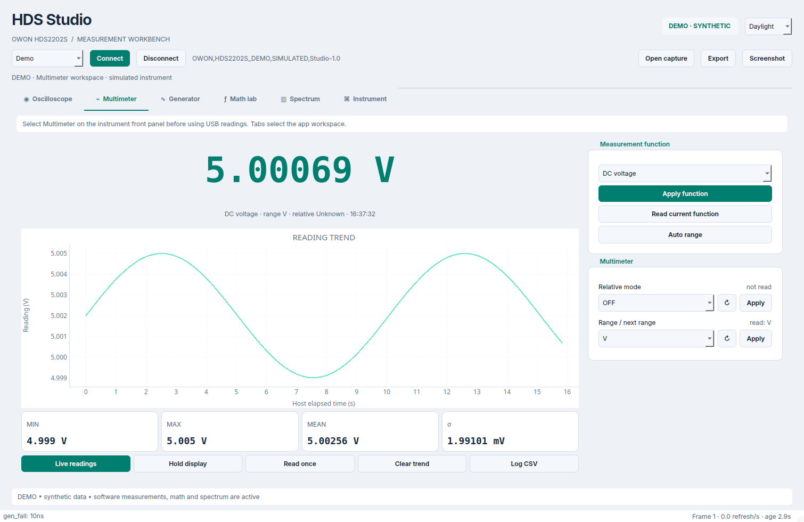
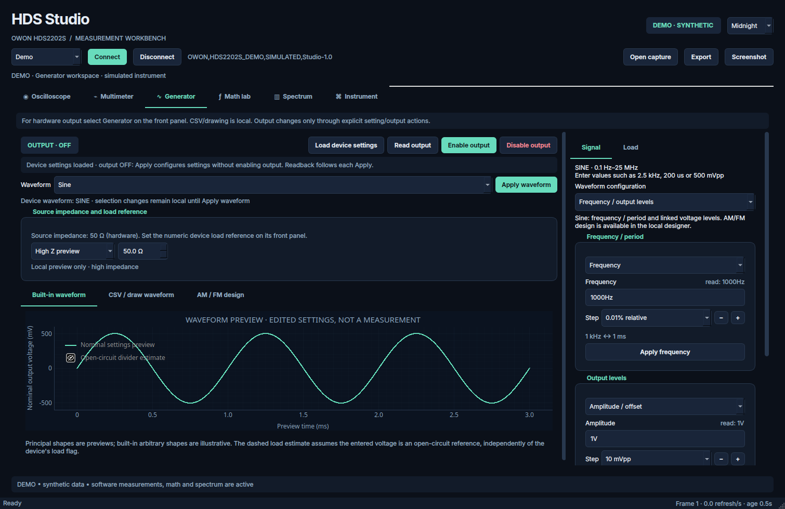
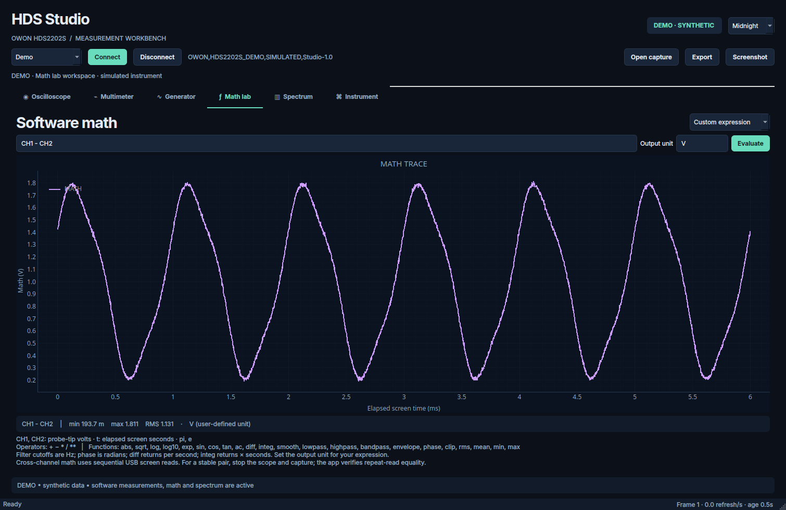
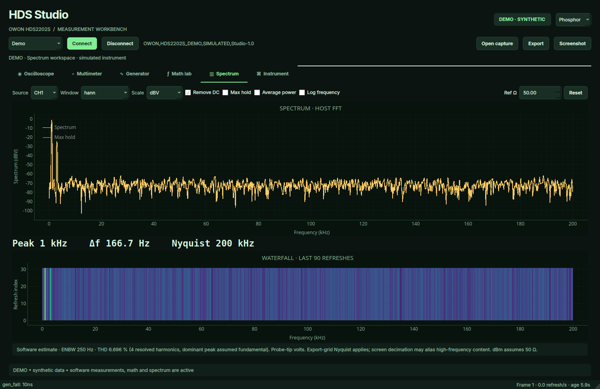
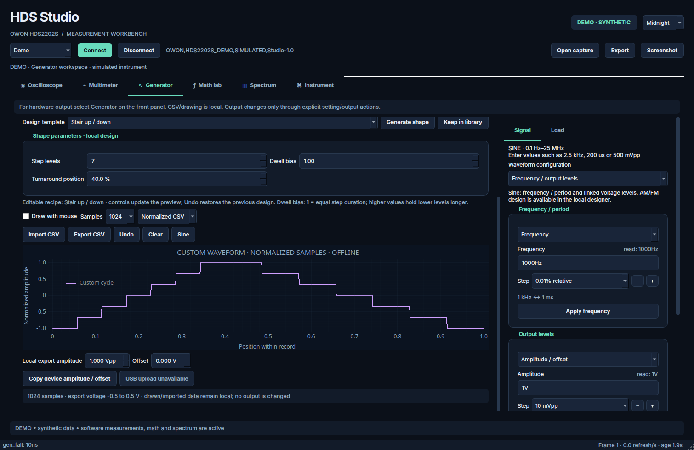

# HDS Studio

**A Linux-focused Python desktop workbench for the OWON HDS2202S: live waveforms, instrument controls, software math, and spectrum analysis.**

HDS Studio is intended to bring Linux support to the OWON HDS2202S. It brings the oscilloscope, multimeter, and function generator into one themed desktop application, with a synthetic demo instrument for exploring the interface without hardware. This is an independent community project; hardware validation is still needed.


## Features

- **Oscilloscope:** two-channel live plots, acquisition and trigger controls, live trigger labels and a voltage-level marker, XY view, time/voltage cursors, reference trace, native and software measurements.
- **Multimeter:** voltage, current, resistance, capacitance, diode and continuity controls; scope function/range unit readback, live readout, trend plot, stable statistics cards, and CSV logging.
- **Function generator:** always-available selection and local editing, all 12 built-in device shapes, explicit Apply/output control, device state loading, load ON/OFF with readback, and a local load preview. Import CSV or draw directly from the selector, use 17 design templates, and keep named custom cycles in a persistent local library for preview/export.
- **Parametric custom shapes:** staircase level count/dwell/turnaround; sinc zeros, width, position, and taper; Bessel order/span/decay; burst envelopes; pulse duty; Gaussian width; and chirp sweep settings. Live previews, recipe saving, and undo preserve editable designs. CSV and hand-drawn samples stay intact until you explicitly generate a replacement.
- **Linked generator controls:** frequency ↔ period, amplitude/offset ↔ high/low, and pulse width ↔ duty. Signal/Timing/Load menus follow the selected waveform. Apply works with output on, accepts values such as `500 mVpp`, and verifies grouped voltage readback.
- **Waveform configurations and steps:** PWM percent, pulse width, rise/fall edges, triangle, and rising/falling sawtooth setups. Each numeric parameter has its own step selector, ± buttons, and keyboard fine/coarse adjustment. Workspace presets retain these preferences; setup selection only edits drafts.
- **AM/FM design:** local modulation preview and CSV export with modulating shape, frequency, AM depth, and FM deviation. Native hardware modulation and custom-waveform upload remain unavailable.
- **Math lab:** custom expressions, differential voltage, derivative, integral, smoothing, low/high/band-pass filters, envelope, phase, and statistics.
- **Spectrum:** FFT, five window functions, RMS/dBV/dBm/PSD scales, power averaging, max hold, waterfall, and harmonic estimates.
- **Capture tools:** compressed waveform files, CSV with metadata, recording, replay, PNG screenshots, and workspace presets.
- **Instrument tools:** complete waveform metadata, command catalogue, SCPI console, and trace export.
- **Three themes:** Midnight, Daylight, and Phosphor.

## Screenshots

All screenshots show **synthetic demo data**. They illustrate the interface; they are not hardware validation results.

| Multimeter · Daylight | Generator · Midnight |
| --- | --- |
|  |  |

| Math lab · Midnight | Spectrum · Phosphor |
| --- | --- |
|  |  |



View the [complete screenshot gallery](screenshots/README.md): six workspaces plus waveform design, modulation, pulse timing, ramp, edge setup, and custom staircase/sinc views in all three themes, **39 screenshots** in total.

## Quick start

Python 3.10 or newer is required. From this repository's root:

```bash
python -m venv .venv
source .venv/bin/activate
python -m pip install -r requirements.txt
python launch.py
```

On Windows PowerShell, use `.venv\Scripts\Activate.ps1` instead of the `source` command. Demo mode starts automatically. Start disconnected with `python launch.py --no-demo`.

Linux/macOS users can also run `bash run.sh`. Set `HDS_STUDIO_PYTHON=/path/to/python` to choose an interpreter. The launcher recognizes the original development computer's existing environment as a convenience; direct execution with `python launch.py` works in your own environment.

## Connect an HDS2202S

1. Connect the scope by USB and select **System → USB → HID** on its front panel.
2. Close other software that is using the instrument.
3. Select **USB • HDS2202S** in the app and click **Connect**.
4. Select the matching Scope, Multimeter, or Generator mode on the instrument front panel.
5. Apply individual settings and check the displayed readback.

USB access requires PyUSB, the system libusb backend, and operating-system device permissions. See the [user guide](docs/USER_GUIDE.md#linux-usb-access) for Linux access rules and connection details.

## Measurement scope and validation

The implemented USB interface reads **screen waveform exports**, rather than a continuous raw ADC stream. Math and FFT use the exported time grid. Paired screen extrema are displayed as envelopes, with midpoint-derived analysis labeled as estimates. See [measurement interpretation](docs/USER_GUIDE.md#measurement-interpretation) for scaling, synchronization, and spectrum limitations.

The app implements the remote functions exposed by its HDS200 command catalogue. Some front-panel/system functions have no documented command. Front-panel mode selection remains necessary: changing tabs selects the app workspace and polling, and does not switch the instrument's screen mode. USB users receive a dismissible **Press Mode on scope** notification when the required mode changes, alongside a persistent reminder above the tabs. No verified remote command for that switch is available in the referenced protocol.

The generator's physical source impedance is **fixed at 50 Ω**. Set its numeric load reference on the scope's front panel; the app's numeric load selector is a local theoretical preview. The documented remote load control is only an ON/OFF flag. Custom CSV/drawn waveforms can be previewed and exported, but **cannot be uploaded to the scope through this app**, because no working custom-waveform transfer command has been verified. See the [generator guide](docs/USER_GUIDE.md#function-generator-and-waveform-editor) for the distinction and operating steps.

**118 automated tests passed** during development, covering recorded HDS2202S decoding, numerical analysis, command validation, USB framing/error handling, multimeter units and layout stability, generator state/output guards, selection after readback failures, device load commands, CSV parsing/drawing, template/library round trips, exports, trigger labels, mode notifications, and the demo UI. Live hardware control, generator output, multimeter accuracy, and USB throughput still require on-device validation. Linux is the current target; hardware operation on Windows/macOS has not been verified.

## Contributions welcome

If you would like to improve Linux support for this scope, please feel welcome to contribute. Bug reports, documentation fixes, ideas, and pull requests are all appreciated. Help with Linux USB compatibility, testing on real hardware, firmware protocol research, and additional analysis tools is especially useful. Thank you for sharing your improvements with the community. See [CONTRIBUTING.md](CONTRIBUTING.md) for a few practical starting points.

## Documentation

- [User guide](docs/USER_GUIDE.md): controls, USB setup, math examples, file formats, and measurement details.
- [Screenshot gallery](screenshots/README.md): every workspace and theme.
- [GitHub description](GITHUB_DESCRIPTION.md): suggested repository name, About text, topics, and project summary.

## Development

Run the tests from the repository root:

```bash
python -m unittest discover -s tests -v
```

Generate screenshots without a display:

```bash
python launch.py --preview-dir screenshots
```

Create a ZIP containing the source, documentation, tests, and screenshots:

```bash
python package.py
```

```text
hds2202s_studio/
├── README.md
├── GITHUB_DESCRIPTION.md
├── CONTRIBUTING.md
├── launch.py
├── run.sh
├── requirements.txt
├── package.py
├── hdsstudio/             Application, USB transport, and analysis
├── assets/               Application icon
├── docs/USER_GUIDE.md     Detailed operating guide
├── examples/             Example custom waveform CSV
├── screenshots/          Gallery and 39 PNG screenshots
└── tests/                Numerical, transport, and UI checks
```

## Protocol reference

Remote controls are based on the [OWON HDS200 Series SCPI Protocol](https://www.owon.co.jp/download/01a0bfb9-2919-7571-866b-44f3d2bb3464/), with previously exercised local transport and run/stop conventions described in the user guide. HDS Studio is an independent application and is not affiliated with or endorsed by OWON.
