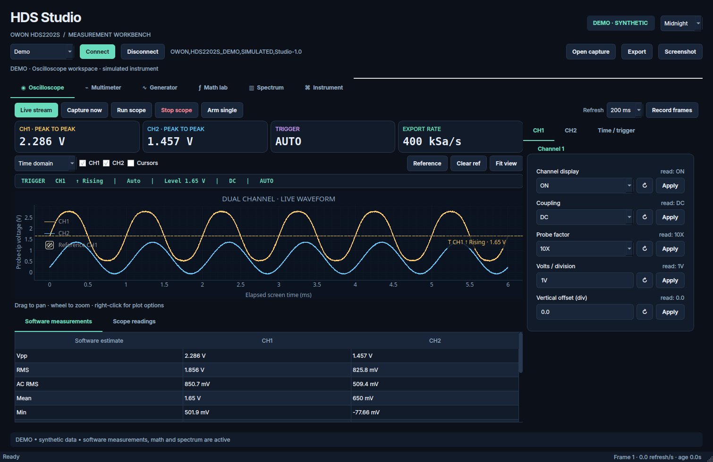

# HDS Studio

A standalone Python desktop workbench intended to bring **Linux support to the OWON HDS2202S**. Uses PySide6, pyqtgraph, NumPy, SciPy and PyUSB. The existing ThermoLab application and thermal-model files are untouched.



[Project README](../README.md) · [Screenshot gallery](../screenshots/README.md)

## Launch on this computer

From the `article` directory:

```bash
bash hds2202s_studio/run.sh
```

The launcher uses the existing `tf218` Python environment, which already contains the dependencies. It opens in **Demo** mode with live synthetic signals. Select **USB • HDS2202S**, then **Connect**, for the instrument. To start disconnected:

```bash
bash hds2202s_studio/run.sh --no-demo
```

To choose another Python environment:

```bash
HDS_STUDIO_PYTHON=/path/to/python bash hds2202s_studio/run.sh
```

On another computer, create an environment and install:

```bash
python -m venv .venv
# Linux/macOS
source .venv/bin/activate
# Windows PowerShell: .venv\Scripts\Activate.ps1
python -m pip install -r requirements.txt
python launch.py
```

USB mode also needs the operating system's libusb backend and device access. Linux is the target platform for the existing transport; this release has not been tested with hardware on Windows or macOS. Demo mode has no USB dependency at runtime.

## Workspaces

| Tab | Functions |
| --- | --- |
| Oscilloscope | Live two-channel plots, channel enable/coupling/probe/scale/offset, horizontal scale/offset, acquisition mode, memory depth, trigger source/edge/coupling/level/mode, live trigger labels and voltage marker, run/stop and single arming, XY view, reference CH1 trace, draggable time and voltage cursors, software measurement table, all 14 native scope measurements, frame recording |
| Multimeter | DC/AC voltage, DC/AC current, resistance, capacitance, diode, continuity, relative mode, range advance, mV/V range, auto range, live numeric reading, trend, min/max/mean/std, display hold, CSV logging |
| Generator | Always-available selector with all 12 built-in shapes, CSV/draw entries and saved cycles; existing-device state loading, explicit Apply/output control, device load ON/OFF/readback, local load preview, 17 offline templates and a persistent local waveform library |
| Math lab | Custom expressions, arithmetic, derivative, integral, smoothing, filters, analytic envelope/phase, scalar statistics; configurable output-unit label |
| Spectrum | Real FFT, Hann/Hamming/Blackman-Harris/flat-top/rectangular windows, DC removal, Vrms/dBV/dBm/PSD, log frequency, exponential power averaging, max hold, waterfall, peak frequency, bin spacing, ENBW and a resolved-harmonic THD estimate |
| Instrument | Complete JSON waveform header and capture provenance, command catalogue, SCPI console and trace export, save/load workspace presets |

Themes: **Midnight**, **Daylight**, **Phosphor**. Theme and window geometry persist through Qt's user settings. Hardware settings and generator output are never restored automatically.

## Hardware connection and controls

1. Connect the HDS2202S USB cable. Select **System → USB → HID** on the instrument. Despite that front-panel name, the exercised transport uses bulk USB endpoints, vendor/product ID `5345:1234`.
2. Close other software using the scope, including an active ThermoLab capture process.
3. Choose **USB • HDS2202S** and **Connect**. The app checks the model identity and starts screen polling when a scope workspace is active. Connecting sends no setting writes.
4. Choose Scope, Multimeter or Generator on the **instrument front panel**, then choose the corresponding app tab. The published protocol does not provide a documented mode-switch command. App tabs choose which data are polled.
5. Use **Apply** to change an individual hardware setting. The adjacent `read:` value is its hardware reply. **↻** queries without writing. Edited controls remain separate from live readback until applied or explicitly queried. Actual readback governs the displayed setting if firmware adjusts or ignores the request.

The scope's **Live stream** button and the meter's **Live readings** button control host polling. **Stop scope** controls the instrument acquisition. **Hold display** freezes only the meter display while readings and a configured CSV log continue. Frame recording follows scope/math/spectrum polling; it pauses in the generator, multimeter and instrument workspaces.

The **TRIGGER** strip above the scope plot shows the source channel, rising/falling edge, Auto/Normal/Single sweep mode, voltage threshold, coupling, and acquisition status from the captured waveform header. The horizontal dashed trigger-level line matches the source channel's color and carries a voltage label. It is hidden in XY view or if the header has no valid source/level. Editing a control does not move this marker until a received header reports the new value. Saved and disconnected captures are labeled as saved or cached. The marker denotes a voltage threshold; it does not assign a trigger time to the elapsed screen coordinate.

**App tabs and front-panel modes:** changing tabs chooses host polling and analysis. It does not select Scope, Multimeter, or Generator on the scope's own screen. There is no verified USB command for that selection in the referenced protocol. When connected by USB, the app displays the required mode above the tabs and shows a **Press Mode on scope → [mode]** notification when that target changes. Press the scope's physical **Mode** key until its screen matches the app. The notification can be dismissed with × and closes automatically after 12 seconds; it does not move or resize the window. Math and Spectrum both use Oscilloscope mode. The Instrument console has no required mode. Demo mode has no physical-mode notification. Entering the Generator tab never enables generator output.

**Multimeter units:** each reading is paired with `:DMM:CONFigure?` and `:DMM:RANGE?` before and after the transfer. This resolves bare numeric replies to the scope's current measurement unit, including Ω for resistance/continuity, V for voltage/diode, A for current, and F for capacitance. An explicit unit in the measurement reply takes precedence. When the range explicitly reports a prefix such as mV or kΩ, a bare reading follows that display unit; the trend and CSV numeric column are converted to base SI units. A front-panel function/range change during transfer invalidates the reading and is retried. This additional readback adds USB work to each meter refresh. An unapplied dropdown selection is never used to label measured values. Unknown or conflicting readback shows a short pending-status message rather than assigning a unit. The original reply remains in the numeric readout tooltip and CSV. Statistics use compact SI prefixes, with a fixed four-card layout and a fixed trend-axis width to prevent the window shifting as values change.

**Arm single** sends the locally exercised stop → single sweep → run sequence and reads trigger status. **Capture now** reads the current scope screen, or one DMM reading in the meter workspace. It does not independently trigger a fresh acquisition. A stopped screen is read twice per channel and must match before the capture is accepted. This confirms a stable screen pair, not simultaneous raw ADC samples.

Disconnecting releases USB ownership and restores a temporarily detached Linux `usb_serial_simple` driver. It leaves current instrument settings and generator output in their current state. The app does not reset the scope.

### Linux USB access

If connection reports permission denied, install a rule through your normal system administration process. Example content for `/etc/udev/rules.d/70-owon-hds2202s.rules`:

```udev
SUBSYSTEM=="usb", ATTR{idVendor}=="5345", ATTR{idProduct}=="1234", MODE="0660", TAG+="uaccess"
```

Reload udev rules and reconnect the cable. This application does not install system rules or run as root. It temporarily detaches only the known `usb_serial_simple` driver when needed; it refuses to detach an unknown driver.

## Function generator and waveform editor

### Load existing settings before changes

1. Connect the instrument and select its Generator mode with the physical **Mode** key.
2. Open the app's Generator tab. It automatically makes read-only queries for output state, waveform, frequency, amplitude, offset, and the device load flag. You can also use **Load device settings** next to the output controls. Selection and local editing always remain available, including when disconnected or a readback fails. Initial draft values are for previews, with `not loaded` beside unread fields; they are not claimed to be current device settings. Hardware Apply/output enable stays disabled until loading succeeds. Loading does not enable or disable output.
3. Check the loaded settings and output status. **Apply is available with output ON**: explicit parameter changes take effect live, with an OUTPUT ON message above the selector. Applying settings never toggles output. **Disable output** remains available even if settings could not be loaded.
4. Choose a waveform in the main **Waveform** selector and use **Apply waveform** to send it. It includes Sine, Square, Ramp/triangle, Pulse, and all eight device arbitrary shapes: AmpALT, AttALT, StairDn, StairUD, StairUp, Besselj, Bessely, and Sinc. Choosing a shape updates its local preview without sending a command. You can always switch back from the custom editor to a built-in shape. On the right, **Signal**, **Timing**, and **Load** organize the controls. Timing appears for Pulse and Ramp only; Square has fixed 50% duty. Local drafts remain separate from readback.
5. Resolve unapplied generator edits before **Enable output**. Applying sends a setting; querying replaces that draft with the device value. Enable output only when the displayed readback is the intended configuration.

Before a generator write or output enable, the app reads the core settings again. If they differ from the loaded snapshot, it refreshes readback and rejects that operation so you can review and apply again. This detects changes to the readable core settings; it is not a hardware interlock and cannot detect every possible front-panel change between USB operations. Each successful generator change refreshes core readback. Amplitude/offset and output-enable operations validate the nominal ±2.5 V envelope. Actual output voltage and load compensation still need verification on the instrument. Amplitude readback also accepts an explicit Vpp suffix, and load readback accepts an explicit High Z or resistance value if the firmware returns one. A readback failure leaves selection/local editing available and displays a retry explanation in the Generator panel.

The SCPI console uses the same generator-state and output guards. Disconnecting leaves the scope's output state unchanged.

### Frequency, voltage, and pulse editing modes

In **Signal → Frequency / period**, select Frequency or Period as the editable quantity. Enter SI values such as `2.5 kHz`, `0.4 ms`, or `200 us`; the other quantity updates using `period = 1 / frequency`. **Apply frequency** sends the corresponding frequency command and checks readback. Bounds follow the actual device waveform: Sine up to 25 MHz, Ramp up to 1 MHz, and the remaining catalogue shapes up to 5 MHz. Apply the selected waveform first if the instrument is still using another shape.

In **Signal → Output levels**, choose **Amplitude / offset** or **High / low**. Examples include `500 mVpp`, `1.5 Vpp`, `100mV`, and `-0.25 V`. The linked values follow:

```text
high = offset + amplitude / 2       low = offset - amplitude / 2
amplitude = high - low             offset = (high + low) / 2
```

The summary shows all four quantities, and switching modes keeps the same draft signal. Typed text is retained while editing; derived fields update without rewriting the active input. **Apply voltage levels** validates the complete pair, then sends amplitude and offset commands even when you edited high/low. It orders the writes so each intermediate nominal envelope fits ±2.5 V, and checks readback after each write. The pair is not an atomic instrument operation: a valid intermediate output can occur. If a write is ignored or readback differs, remaining writes stop and the actual readback is shown. A timeout disconnects USB. Newer edits made while Apply runs remain drafts.

Use **Reload signal values (discard drafts)** to replace frequency and voltage drafts with new device readback. The top **Load device settings** refreshes readback while preserving unapplied edits. Workspace presets remember the selected editing modes and never apply settings to the device automatically.

For **Pulse**, open **Timing** and choose **Duty cycle (%)** or **Pulse width (s)**. Width and duty update together using the draft frequency. Apply waveform and frequency first, then **Apply pulse timing**. Width must fit the actual period, with duty between 0.1% and 99.9%. **Read pulse timing** reads the active width/duty representation and the edge-time fields. Rise/fall fields retain individual ↻/Apply buttons. Read a field or explicitly edit its draft before applying; Pulse must already be active on the device, and edge times cannot exceed its period. For **Ramp**, Timing contains symmetry with its own ↻/Apply, enabled after a read or explicit edit while Ramp is active. Timing values shown as `not loaded` are drafts, not measured or queried device values.

### Waveform configurations and parameter steps

The **Waveform configuration** selector appears in Signal and Timing. Its choices follow the selected device waveform:

| Waveform | Available configuration |
| --- | --- |
| Sine | Frequency or period, with linked voltage levels |
| Square | Fixed 50% square; PWM preparation switches the local waveform draft to Pulse |
| Pulse | PWM duty in percent; pulse width in time; rise/fall edge timing |
| Ramp | Adjustable symmetry; Triangle 50%; rising sawtooth 100%; falling sawtooth 0% |
| AmpALT, AttALT, StairDn, StairUD, StairUp, Besselj, Bessely, Sinc | Frequency or period and voltage levels for the selected fixed built-in shape |

Selecting a configuration opens the relevant controls and focuses its main parameter. Triangle/sawtooth choices prepare a symmetry draft. Square → PWM prepares a Pulse draft and its percent editor; use **Apply waveform** before applying PWM duty. Here PWM means configuring a pulse train's duty, not streaming a modulation sequence. No configuration selection sends a setting or toggles output. Built-in arbitrary internals have no documented editable parameters, so the app exposes their common frequency/level controls rather than inventing extra device controls.

Every numeric generator field has an independent **Step** selector and **− / +** buttons. You can still type a complete SI value directly. Defaults are:

| Parameter | Default UI increment | Other choices |
| --- | --- | --- |
| Frequency | 0.01% of the current draft frequency | Absolute increments from 0.1 Hz to 1 MHz |
| Period | 10 µs | ns, µs, ms, and seconds |
| Amplitude | 10 mVpp | 1 mVpp, 100 mVpp, 1 Vpp |
| Offset / high / low | 10 mV | 1 mV, 100 mV, 1 V |
| Pulse width | 1 µs | ns through seconds |
| PWM duty | 1 percentage point | 0.1, 0.5, 5, or 10 percentage points |
| Rise / fall | 1 ns | ns through seconds |
| Ramp symmetry | 1 percentage point | 5 or 10 percentage points |

With a value editor focused, **Up/Down** uses that field's step, **Shift+Up/Down** uses ten times the step, and **Ctrl+Up/Down** uses one tenth. Ramp symmetry stays integer-valued because its command requires an integer percentage. Step changes remain local and update linked fields. A step that exceeds the current voltage envelope, waveform frequency limit, or timing range is rejected without silently clamping the value. UI increments do not guarantee the device accepts that resolution; readback remains authoritative.

Workspace presets save each field's step and the remembered configuration for each waveform alongside the editing modes. Loading restores drafts/preferences without sending hardware commands.

### Local AM/FM design

Open **AM / FM design** inside Generator. This tab takes carrier shape, frequency, Vpp, and offset from the Signal drafts. Choose AM or FM, modulation frequency, and a sine, triangle, or square modulating shape. AM offers 0–100% depth and displays its upper/lower envelopes. FM offers frequency deviation, which must remain below the carrier frequency.

The designer renders 8192 samples over three modulation periods. It validates the modulated ±2.5 V envelope and rejects frequency ratios with fewer than 20 samples per highest modeled cycle. Square/triangle transitions remain sampled approximations. Export writes `time_s,voltage_V`; the record is not guaranteed to join seamlessly when repeated, and importing it into the one-cycle editor rescales its time span.

This is **local preview/export only**. The published [HDS200 SCPI catalogue](https://www.owon.co.jp/download/01a0bfb9-2919-7571-866b-44f3d2bb3464/) lists no AM/FM control or custom sample-upload commands. Native modulation has not been verified for this device, and the app does not emulate it with repeated USB setting writes. Modulation design/export never changes device output.

### Source impedance and load reference

The HDS2202S has a **fixed 50 Ω source impedance**. Its front-panel output-load reference can be High Z or 1 Ω–10 kΩ; this reference is distinct from the physical source resistance. See the [manufacturer user manual](https://www.owon.co.jp/download/01a11fa0-bd24-74aa-91d3-743c2914a85a/) and [specifications](https://www.owon.com.hk/products_owon_hds200_series_digital_oscilloscope).

The published [SCPI protocol](https://www.owon.co.jp/download/01a0bfb9-2919-7571-866b-44f3d2bb3464/) exposes only `:FUNCtion:LOAD ON/OFF`, without a numeric resistance command or a verified mapping of that flag to High Z versus 50 Ω. The **Load** menu on the right contains the real **Device load flag** selector, its **↻** query, and **Apply**. With device settings loaded, selecting ON/OFF and applying sends that command and displays readback. The app preserves its raw ON/OFF meaning instead of assuming which front-panel impedance each state represents. Explicit High Z/numeric readbacks are displayed without inventing a numeric write command. Set the numeric hardware load reference on the scope's front panel.

The separate **local load preview** lets you choose High Z or a resistance from 1 Ω to 10 kΩ. It sends no commands. The dashed trace applies the theoretical divider `R / (50 + R)` to an illustrative open-circuit waveform, or unity for High Z. It does not model firmware load compensation or predict a calibrated terminal voltage from the device's amplitude readback. It cannot reconfigure the physical impedance.

### Import, draw, and export a custom cycle

Use the main **Waveform** selector's **Arbitrary · import CSV…** or **Arbitrary · draw your own** entry. Import opens the file picker directly; Draw opens the editor with mouse drawing enabled. You can also open the **CSV / draw waveform** tab. This is an offline design tool: importing, drawing, changing local voltage fields, or exporting never changes generator settings or output. **USB upload unavailable** is intentionally disabled because no working custom-waveform upload command has been verified. The instrument's documented built-in arbitrary waveforms are separate from importing your own samples.

Choose a sample count from 256 to 8192. The **Design template** selector offers 17 mathematical shapes, each with its own **Shape parameters** panel. These are local designs, separate from the instrument's fixed built-in arbitrary shapes.

| Local shape | Customization |
| --- | --- |
| Stair up / down / up-down | 2–64 level values; dwell bias; up-down turnaround position (10–90% of the record) |
| Sinc | 1–16 zeros on each side; total window width (5–100%); center; rectangular, Hann, or Blackman taper |
| Bessel J / Y | Integer order (0–8); argument start and span; envelope decay |
| Rising / falling sine burst | Carrier cycles; phase; envelope power; envelope floor |
| Sine, sawtooth up/down | Cycles per record; phase |
| Square / pulse | Cycles; phase; duty cycle (0.1–99.9%) |
| Triangle | Cycles; phase; peak position / rise fraction |
| Gaussian pulse | Center; Gaussian standard deviation as a percentage of the record; bipolar/unipolar shape |
| Exponential decay | Time constant as a percentage of the record; rise/decay; bipolar/unipolar shape |
| Chirp | Start/end cycles per record; phase; linear/logarithmic sweep |

Each numeric control has its own appropriate increment. Staircase levels are distinct values including −1 and +1; dwell bias 1 gives equal durations, while higher values hold lower levels longer. Up-down returns to its starting level. Sinc window width spans the full cropped support, and the zero count controls oscillations within that window. Bessel argument controls are dimensionless; Y requires a positive argument start. Cycles are counts across the exported record, not hardware frequency settings.

For a generated recipe, selecting a template or changing its parameters updates the preview immediately. Per-shape settings are remembered while switching templates. Resampling regenerates an active recipe, preserving exact staircase levels. The app checks sample density for configured cycles, sinc oscillations, and staircase levels. Invalid parameter edits keep the previous valid samples and block saving/export until corrected or undone. A rejected sample-count change restores the previous count. Records are sampled approximations and are not guaranteed to join seamlessly when looped.

Click **Generate shape** to create the selected design explicitly, **Clear** to zero, or enable **Draw with mouse** and drag across the canvas. A stroke interpolates between points. Drawing, Clear, and CSV import detach the samples from the recipe: changing template controls then leaves those samples intact until you click **Generate shape**. **Undo** restores samples and their editable recipe together. With Draw off, the plot retains pan/zoom controls.

Use **Keep in library** to give a cycle a name. Saved cycles appear as **Saved · [name]** in the main Waveform selector and survive app restarts. Saving under an existing name replaces that entry. The library stores samples, local amplitude/offset, and an editable recipe for generated shapes, with a maximum of 50 entries. Older sample-only entries still load. Drawn/imported cycles remain sample-only. On Linux the file normally lives at `~/.local/share/hds-studio/waveforms.json` (or the corresponding XDG data directory). Corrupt libraries are reported and not overwritten. Selecting a saved cycle restores its local design without sending commands. Export CSV for a portable copy of the samples; CSV does not retain the recipe controls.

Use **Import CSV** with **Normalized CSV** or **Volts CSV** selected, for any of these formats:

- One numeric column of normalized values in `[-1, 1]`, or voltage values with **Volts CSV** selected.
- Two columns containing strictly increasing position/time and sample values. Positions are rescaled across one cycle; importing does not set generator frequency.
- An exported file with named `phase`, `normalized`, and `voltage_V` columns. A named `normalized` column takes precedence; a named `voltage_V` column is interpreted in volts.

Comma, semicolon, and tab separators are supported, with recognized optional headers, blank lines, and `#` comments. The selected sample count is filled by linear interpolation. Invalid, nonfinite, unordered, or out-of-range data are rejected without silently normalizing the waveform. Files are limited to 4 MB and 100,000 data rows. Try the included [example cycle](../examples/custom_cycle.csv).

The editor's local Vpp and offset map normalized samples to `voltage = offset + normalized × Vpp / 2`. **Copy device amplitude / offset** copies the loaded device values into the editor without sending commands. Voltage CSV imports are converted using these local values, so set them first. Export writes `phase,normalized,voltage_V` after validating voltage limits. This CSV is a design file, not a supported instrument-upload format, and its voltage column is not a measured output.

## Measurement interpretation

The USB commands export **screen waveforms**, with 300 horizontal positions and either 300 signed pixel codes or 600 bytes of paired extrema. Voltage uses the project's exercised convention of 25 signed pixel codes per division. `:CHn:SCALe?` includes the configured probe factor, so displayed/exported values are **probe-tip volts with that factor applied once**. The recorded test fixture checks the sign, offset and probe scaling against previous HDS2202S readouts. It is not an independent calibration.

The app uses 12 time divisions to calculate exported time spacing. For example, 500 µs/div gives a 6 ms screen, 20 µs spacing, 50 kscreen positions/s and a **25 kHz export-grid Nyquist frequency**, even when the header reports a much faster internal ADC rate. The horizontal trigger offset is retained in metadata; the plotted coordinate is elapsed screen time starting at zero. Roll/slow-move export is rejected because its time mapping is not implemented.

Where firmware supplies differing extrema for a screen position, the scope tab shows the min/max envelope. Software math and FFT use its midpoint and are labeled **estimates**. They cannot recover raw samples, remove screen-decimation aliasing, restore clipped peaks or reproduce the scope's full 200 MHz hardware bandwidth. The original bytes and full header remain in exported captures. Native measurement queries appear in a separate table and can differ from measurements of screen midpoints.

Cross-channel arithmetic uses sequential USB reads while the instrument runs. Use **Stop scope**, then **Capture now**, for repeat-verified stable screen pairs. Settings changes during transfer invalidate the frame and trigger a retry. There is no continuous lossless acquisition guarantee or fixed refresh-rate guarantee; USB transfer time is added to the selected polling interval.

Spectrum amplitudes use window coherent-gain normalization. Bin-centered sine waves are reported in RMS volts; PSD uses window-energy normalization. dBm assumes the entered resistance and does not change input impedance. A spectral line away from a bin center can have amplitude scalloping; flat-top reduces it. Power averaging is exponential, with 15% new data per refresh. THD integrates resolved lobes up to the fifth harmonic, assumes the strongest non-DC peak is the fundamental, and reports only harmonics below the export Nyquist limit. It is not a calibrated distortion measurement.

## Math examples

```text
CH1 - CH2                       Differential voltage
(CH1 - CH2) / 0.1               Current through a 0.1 Ω shunt; set output unit A
CH1 * CH2                       Product; choose the appropriate output unit
diff(CH1)                       Derivative; V/s
integ(ac(CH1))                  Integrated AC component; V·s
smooth(CH1, 9)                  Nine-point moving average
lowpass(CH1, 10000)             Fourth-order zero-phase low-pass, cutoff in Hz
highpass(CH1, 100)              High-pass
bandpass(CH1, 100, 10000)       Band-pass
envelope(ac(CH1))              Hilbert envelope
phase(ac(CH1))                 Unwrapped analytic phase, radians
rms(CH1)                       RMS as a constant trace
clip(CH1, -1, 1)               Software clipping
```

Also available: `abs`, `sqrt`, `log`, `log10`, `exp`, `sin`, `cos`, `tan`, `mean`, `min`, `max`, `pi`, `e`, and elapsed time `t`. Expressions use a bounded AST interpreter; Python imports, attribute access and arbitrary code execution are not allowed. Invalid operations clear the math trace and show an explanation. Filter cutoffs must be below the export-grid Nyquist frequency. Filters, derivatives and Hilbert transforms have finite-record edge effects. When analyzing MATH in voltage spectrum units, its output is assumed to be volts; use an appropriate expression.

## Files and recording

- **Export** (`Ctrl+S`): compressed `.npz` capture including time, both channels, envelopes when available, optional math, full header, provenance and raw USB hex. CSV export writes a matching `.csv.json` metadata sidecar.
- **Open capture** (`Ctrl+O`): load an exported `.npz`, pause polling, and inspect it with math/spectrum. Replay is labeled. Resume Live stream to return to acquisition.
- **Record frames**: create a new timestamped directory with numbered compressed frames. Each contains its own header and host timestamp. These are polled screen snapshots.
- **Log CSV**: create a new meter log, preserving original readings, SI numeric values when parsed, base SI units, device identity and known function/range/relative readbacks. Units are resolved from an explicit reading suffix or contemporaneous scope function/range readback. Existing logs are never overwritten. Unresolved values retain their raw text and leave the numeric SI column empty.
- **Screenshot** (`Ctrl+Shift+S`): save the complete current workbench as PNG. Each plot also has pyqtgraph's right-click view/export menu.
- **Workspace presets**: save edited controls and analysis preferences as JSON. Loading fills the controls for review and does not apply settings to hardware.
- **SCPI console**: one known full-spelling catalogue command at a time. The console supports setting writes as well as queries. It rejects command chaining, resets and commands outside the implemented catalogue.

## Firmware coverage and validation

Controls cover the oscilloscope, DMM and generator functions exposed by the linked HDS200 protocol, with firmware readback. `:RUNning RUN/STOP` and single arming use the command spelling already exercised in this project's acquisition code. The manual contains inconsistent trigger and generator spellings; generator symmetry/width use the syntax-section names, and pulse duty uses `:FUNCtion:PULSe:DTYCycle`. Actual firmware support for these commands, built-in arbitrary waveform names and the load setting still needs confirmation on the connected device. This app does not silently substitute alternate commands after an error.

The public protocol does not expose every front-panel/system function: no documented battery/status-icon query, pixel screenshot, front-panel key emulation, custom arbitrary-wave upload, firmware upgrade, or mode-switch command is implemented here. The Instrument tab shows all header information the waveform export provides. A hardware error or timeout releases USB and discards queued operations so a late response cannot be reused as a different reading. Reconnect after resolving the reported command/connection issue.

**Validated locally:** all 118 automated tests pass. Coverage includes recorded HDS2202S decoding, multimeter function/range units, SI conversion and transfer changes, CSV provenance, stable meter geometry, command bounds, spectrum normalization, FFT edge cases, THD, math restrictions, fragmented USB framing, frozen-frame checks, exports, timeout disconnects, demo UI/themes, output readback, cursors, recording, overload display, presets, replay protection, preservation of newer edits, trigger labels/markers, and mode notifications. Generator checks include read-only state loading, external changes, output gating, pending drafts, voltage bounds, local load previews, alternate readback formats, device load commands, selector/keyboard behavior after readback failure, switching between device/CSV/drawing/library entries, repeatable/distinct previews, template bounds, persistent library round trips, CSV validation, and drawing/undo without USB writes. Further checks cover Vpp units, live voltage Apply, safe write ordering, ignored-write handling, paired editing modes, typed-text preservation, pulse constraints, modulation envelopes, FM instantaneous frequency, time/voltage CSV export, independent parameter steps, keyboard modifiers, step bounds, draft-only PWM/ramp setup selection, waveform-specific write validation, and restored adjustment preferences. Parameterized-shape checks cover staircase counts/dwell/turnaround, sinc zeros/taper, Bessel domains, envelopes, sampling rejection, old template aliases, recipe persistence, protected CSV/drawing edits, and recipe-aware undo. All six workspaces, waveform design, modulation, pulse timing, ramp setup, edge timing, custom stairs, and custom sinc have generated previews in all three themes, totaling 39 screenshots.

**Hardware validation outstanding:** this workspace exposes no `/dev/bus/usb` or oscilloscope serial device. No live USB connection, generator output, DMM accuracy or acquisition throughput was tested during this build.

Run the included tests:

```bash
python -m unittest discover -s tests -v
```

Regenerate screenshots without a display:

```bash
python launch.py --preview-dir screenshots
```

## Sources

- [OWON HDS200 Series user manual, manufacturer PDF](https://www.owon.co.jp/download/01a11fa0-bd24-74aa-91d3-743c2914a85a/)
- [OWON HDS200 Series SCPI Protocol, manufacturer PDF](https://www.owon.co.jp/download/01a0bfb9-2919-7571-866b-44f3d2bb3464/)
- [OWON HDS200 manufacturer specifications](https://www.owon.com.hk/products_owon_hds200_series_digital_oscilloscope)
- Existing local transport/scaling conventions: `thermolab_scope_v1/app/owon_scope.py`, `peltier_model/src/scope_waveforms.py` and `peltier_model/src/owon_single_shot.py`. HDS Studio is self-contained and does not import these projects at runtime.
- The included fixture preserves provenance from a previous read-only HDS2202S V3.0.0 capture dated 2026-10-21. No measurement data were changed.
